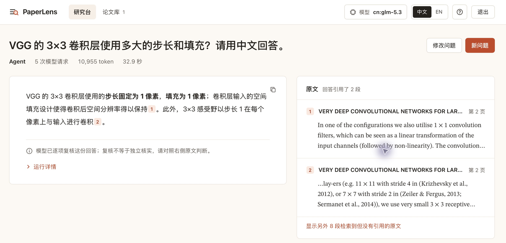
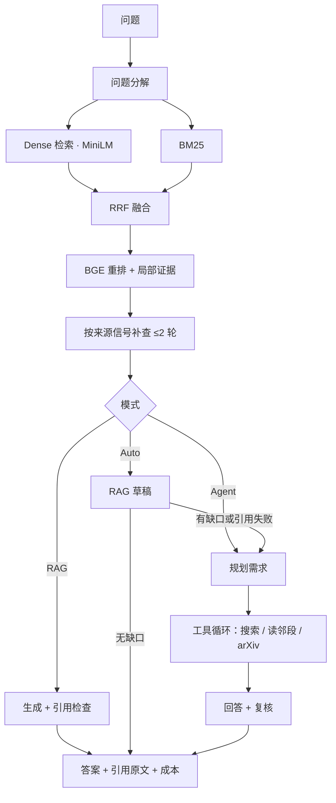

# PaperLens · Advanced-LLM-RAG

[](https://github.com/JAzer-M/Advanced-LLM-RAG/actions/workflows/tests.yml)
[](LICENSE)

面向科研论文的本地问答系统：上传 PDF，提问，得到**每句话都能点回原文段落与页码**的回答。检索是 Dense + BM25 混合召回、RRF 融合加 BGE 重排；回答有三种模式：固定 RAG、按证据缺口自主补查的 Agent，以及先走 RAG、发现缺口再升级的 Auto。



## 功能

- **PDF 入库**：正文提取、基础清理、语义分块、向量化；内容去重，新版本校验通过后原子切换，失败不影响现有库
- **带引用回答**：引用编号对应原文段落和页码，点击即在右侧高亮；未被引用的检索结果也可展开核对
- **三种模式**：RAG（通常 2 次模型请求）/ Agent（搜索、读邻段、停止，最多 3 个工具动作）/ Auto（RAG 优先，必要时升级）
- **可选 arXiv 补证据**：库里没有原论文时，按标题检索并读取 1 篇固定版本 PDF，只用于本次回答
- **网页界面**：中英文界面、回车发送（兼容中文输入法选词）、刷新后接续运行中的任务、在网页里配置任意兼容 OpenAI Chat Completions 的模型服务
- **Mac 应用**：自带 Python 运行时，双击启动，首次使用在网页中一键下载检索模型

## 下载与使用

**Mac（Apple Silicon）**：从 [Releases](https://github.com/JAzer-M/Advanced-LLM-RAG/releases) 下载 `PaperLens-0.1.0-macos-arm64-preview.zip`，解压后双击 `PaperLens.app`。应用未做 Apple 公证，首次打开请右键 → 打开（或运行 `xattr -dr com.apple.quarantine PaperLens.app`）。

1. 浏览器自动打开 `http://127.0.0.1:8849`，点击下载本地检索模型（约 1.6 GB，可断点续传）
2. 在「模型」里填写 API 地址、密钥并选择模型
3. 在「论文库」上传 PDF，入库完成后即可提问

论文、索引、配置和检索模型都保存在本机 `~/Library/Application Support/PaperLens/`。提问时，问题和选中的原文段落会发送给你配置的模型服务。

**从源码运行**（Python 3.11）：完整步骤（含本地模型准备）见[安装与首次启动](docs/INSTALL_AND_START.md)。**Windows** 用 `webui\start.bat` 启动，见其中的 [Windows 小节](docs/INSTALL_AND_START.md#7-windows源码运行验收中)。

```bash
python3.11 -m venv .venv && .venv/bin/pip install -r requirements.txt
.venv/bin/python -B -u webui/server.py      # 打开 http://127.0.0.1:8849
```

## 架构



每条路径都有硬预算：Agent 含分解最多 11 次模型请求，Auto 最坏 13 次；失败不自动重试，超时或 429 会标记为「暂时无法获取」，不会当成「论文未报告」。[结果字段约定](docs/BACKEND_RESULT.md)

## 关键结果

**检索消融**（八篇论文库、42 道有标注题、Top-10）：

| 方法 | Recall | MRR | MAP |
| --- | --- | --- | --- |
| Dense | 0.480 | 0.347 | 0.292 |
| BM25 | 0.581 | 0.386 | 0.342 |
| Hybrid（RRF） | 0.578 | 0.453 | 0.398 |
| + BGE 重排 | 0.693 | 0.551 | 0.471 |
| + 问题分解 | 0.748 | 0.559 | 0.477 |
| + 证据补查（≤2 轮） | **0.768** | **0.571** | **0.484** |

Top-20 的 Recall 只多 4.4 个百分点，没达到事先定的 5 点门槛，所以默认保留 Top-10。

**回答对照**（同题、同库、同模型，12 题，人工按冻结标准评分）：

| 路径 | 严格通过 | 核心要点 | 模型请求 | token |
| --- | --- | --- | --- | --- |
| RAG | 10/12 | 25/27 | 24 | 34,470 |
| Agent | 7/12 | 16/27 | 49 | 95,440 |

这一轮 Agent 质量更低、成本是 RAG 的 2.8 倍，主要失败在需求规划。这是后来改成 **RAG 优先、按需升级** 的 Auto 的直接原因。arXiv 补证据在两道缺原论文的题上把必答点从 5/10 补到 10/10，但 token 增加到 2.5 倍，反例的正确拒答也从 2/2 降到 1/2。

题量小、出题和审阅都不是第三方，以上不是泛化质量证明。所有数字都链接到原始运行记录：[质量与成本总览](docs/PROJECT_METRICS.md)。

## 设计取舍

- **引用可核对优先于回答流畅**：回答中的每个编号都对应一段保存下来的原文，引用登记与检索结果逐字段校验
- **预算显式化**：工具动作、复核轮次、原文字数都有上限，运行结果记录实际请求数和 token
- **失败如实交付**：区分 completed / degraded / failed，降级时说明缺口而不是编造
- **知识库版本化**：索引、分块与清单成套保存并校验哈希，网页入库生成新版本再切换

## 已知局限

- 扫描件没有 OCR，复杂表格和公式的提取有限
- 联网补证据目前只支持 arXiv
- Mac 包仅 Apple Silicon、未公证；Windows 目前只能从源码运行，尚未完整验收
- 当前版本还没有独立新题上的总体质量评测

## 开发

```bash
# 离线测试（模型用替身，不调用 API）
.venv/bin/python -m unittest discover -s tests
.venv/bin/python -B -m unittest webui.test_server webui.test_config webui.test_library webui.test_model_assets webui.test_runtime

# 命令行问答（会调用 API）
.venv/bin/python main.py --mode auto "What batch size does DPR use?"
.venv/bin/python main.py --mode agent --allow-network "According to the Mamba paper, what inference throughput advantage over Transformers is stated in its abstract?"
```

macOS 应用构建见 [packaging/macos](packaging/macos/README.md)。

| 文档 | 内容 |
| --- | --- |
| [PROGRESS](PROGRESS.md) | 当前进度、配置与待办 |
| [PROJECT_METRICS](docs/PROJECT_METRICS.md) | 分版本质量、成本、检索指标和失败案例 |
| [代码阅读指南](docs/CODE_READING_GUIDE.md) | 文件职责与调用关系 |
| [实验索引](evaluation/results/README.md) | 每轮实验的原始记录 |
| [网页说明](webui/README.md) | 网页操作与限制 |

## License

[MIT](LICENSE)
