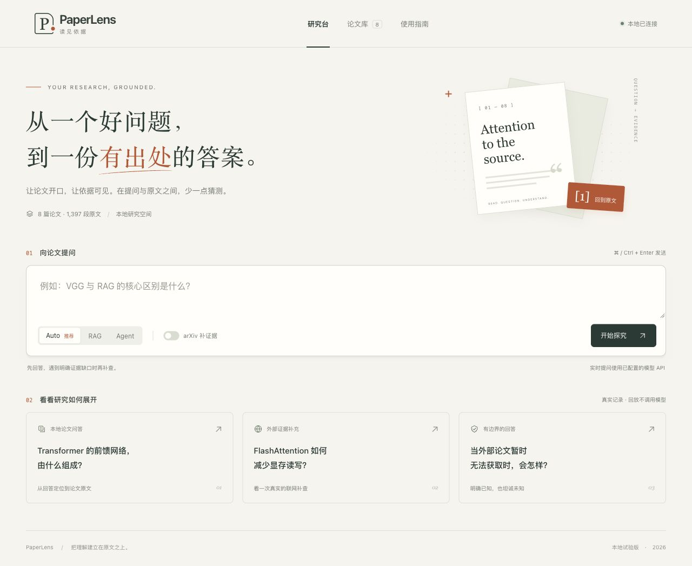

# PaperLens Web UI 从零重做日志

日期：2026-10-23（Asia/Shanghai）

## 目标与最终范围

用户要求重新开始前端设计，不沿用当前页面，先完成一个小而完整的版本，修复过程中遇到的问题，最后由用户验收。

本轮新建 `webui/`，HTML、CSS、JavaScript 全部重写；保留 `ui_prototype/` 原样供对照。新版地址为 **http://127.0.0.1:8849**，旧版仍是8848。没有新增框架、依赖、外部字体或第三方图片，没有发布到公网。

底层仍使用当前 `main()` 与八篇知识库。新服务复用旧服务的元数据、案例、公开结果字段和worker函数；这些是后端数据适配，不是复用旧前端。没有重写检索、Agent、提示词或调用预算。61份已有源码/测试/旧UI文件先保存哈希，交付时逐一核对。

## 设计与实现

### 1. 从提问开始的首页

- 去掉旧版侧栏，改为研究台、论文库、使用指南三个直接入口。
- 暖白背景、深墨绿文字、朱橙引用强调；标题使用系统宋体，正文使用系统无衬线字体。
- 首页以一句清楚的主张和提问框为核心，CSS纸张插图呼应“回到原文”。不加载远程资源。
- 三个案例分别展示本地回答、外部证据和来源不可用。首次打开停留在首页，不把历史答案伪装成刚生成的答案。

### 2. 回答与原文的阅读布局

- 桌面左右显示答案和证据；窄窗口自动上下排列。
- 点击引用编号，展开并聚焦对应原文，保留真实编号、论文、页码和原文。
- 可以查看已引用片段或全部证据，展开/收起原文，打开 arXiv 固定版本 PDF。
- 支持回答中常见的粗体、行内代码、列表、表格、代码块及 HTTP(S) 链接；先转义文字，不直接插入模型生成的 HTML。
- 完整答案可复制；运行记录与答案可用鼠标或方向键切换。

### 3. 真实运行与可理解的状态

- Auto/RAG/Agent沿用原模式；RAG时禁用联网开关。
- 点击发送立即锁定输入与提交按钮，服务端再限制单任务运行。
- 等待页显示实际经过时间，不伪造阶段或百分比。长时间任务提示CPU重排、加载或补查可能耗时。
- 浏览器sessionStorage只保存当前页签草稿、模式及任务/案例编号；刷新后读取原任务状态，不重新发送。
- 轮询断线时保留任务编号，重新连接只读取状态。服务重启导致任务404时明确提示，不自动重跑。
- 新运行文件保存在 `logs/webui/`；UI只收到公开展示字段，不暴露私有配置。

### 4. 小功能与可访问性

- 论文库弹窗可按标题或文件名搜索；空结果有提示。
- 提供使用说明、跳到提问、焦点样式、弹窗Esc关闭、键盘切换及减少动画偏好支持。
- 同一页面中的历史成本和本次成本分别标记。来源不可用、补查未完成、处理失败和普通生成结果分别显示。

## 遇到的问题与处理

| 问题 | 依据 | 处理与结果 |
| --- | --- | --- |
| 旧版视觉结构不符合本次“重新开始”的要求 | 用户明确要求 | 新建独立目录和端口，全新设计，不覆盖旧页面 |
| 本地服务首次无法绑定端口 | 沙箱返回PermissionError，尚未监听 | 通过执行权限审核后启动仅监听127.0.0.1的服务；随后浏览器成功访问 |
| 请求尚未返回时可能快速重复提交 | 阅读旧提交逻辑，忙碌状态在POST返回后才设置 | 新版在发请求前锁定；服务端单任务保护；离线验证第二请求返回409且不创建进程 |
| 刷新后丢失正在运行的视图 | 旧版任务仅由当前JS变量跟踪 | sessionStorage保存任务编号；真实提问后刷新，继续同一任务，最终只生成一份运行记录 |
| 历史回答的Markdown链接露出原始语法 | 浏览器查看FlashAttention案例发现 | 新增经过转义的HTTP(S)链接渲染；刷新后显示可点击“固定版本PDF” |
| 首页装饰竖排文字越过插图区域 | 1280px截图检查发现旋转定位偏移 | 改用writing-mode竖排，避免旋转坐标溢出 |
| 内嵌预览默认仅622px，无法覆盖桌面布局 | 实测视口宽度622px | 使用浏览器官方viewport能力检查1280px和390px；结束前恢复默认尺寸 |
| 普通失败不应被解释为外部论文缺失 | 当前后端存在多种failed/degraded来源 | 仅source_unavailable增加外部获取失败说明；其他状态按本身原因展示 |

自动化过程中一次控制原预览标签时发现标签已因上一轮中断而失效，重新创建本轮预览；一次尝试读取Codex原生窗口被工具禁止，未继续操作该窗口，改用浏览器视口能力完成检查。均未修改系统设置或影响项目文件。

## 验证结果

### 离线接口检查：9项通过

命令：`.venv/bin/python -B -m unittest webui.test_server -v`。

覆盖真实历史结果与状态、元数据私密字段边界、非法输入不启动worker、跨来源POST拒绝、忙碌时拒绝重复提交、轮询不启动/重跑、worker无结果退出时明确失败、未知路径/任务404、内部错误不泄露细节。全部通过，不发网络请求，不调用模型。

原生产测试和核心源码未改变，因此没有重复331项整套历史回归；不能把原331项与本轮9项拼成一次新的全套运行。

### 浏览器实测

- 1280px桌面：首页插图、提问、三张案例卡和答案/证据双栏。
- 622px内嵌窗口：首页和结果区，无横向溢出。
- 390px移动尺寸：提问设置换行、发送按钮整行、答案/证据上下排列，无横向溢出。
- 三类真实案例均加载；来源不可用案例显示搜索失败和未自动重试。
- 引用定位到真实原文、展开/收起、全部证据显示11段（真实VGG运行）。
- 搜索VGG只显示匹配论文；复制答案后读取剪贴板确认文字；方向键切换运行记录。
- 刷新历史记录可恢复；真实运行期间刷新可恢复等待状态。
- 本轮查看浏览器error/warn记录为空。

### 一次真实端到端提问

问题：`According to VGG, what convolution stride and input padding are used for its 3x3 convolution layers?`

| 项目 | 本次实际结果 |
| --- | --- |
| 入口 | 新页面发送 → 新服务 → 独立worker → 现有main |
| 模式 | RAG，固定八篇库，arXiv关闭 |
| 处理/回答状态 | completed / not_reviewed |
| 耗时 | 16.28秒 |
| 实际模型请求 | 2次 |
| Token | 输入2955，输出99，总3054 |
| 请求失败 / usage缺失 / 自动重试 | 0 / 0 / 0 |
| arXiv请求 | 0 |
| 运行目录 | `logs/webui/20261023T075703Z_30b7a376/` |

回答的核心步长和padding均为1像素，与引用[1]的VGG第2页原文一致。回答还带了一句3×3背景，页面按原输出展示；原文中同时存在1×1配置例外，不把这次核心问答验收宣称为“所有背景表述完全无歧义”。本轮未修改模型输出、提示词或旧成绩。

本题是已知开发题，只验证新UI到原后端的链路，不是新的独立准确率，也不证明所有问题都能16秒完成。此首次本地验收只产生上述两次模型请求；用户随后要求的联网验收另列如下。

### 用户追加的一次真实联网验收（2026-10-23 19:31起，Asia/Shanghai）

用户在限额中断后要求继续，并开启联网跑一次。恢复时8849没有监听，重新启动本地服务；没有重跑已完成的VGG验收。选择不在八篇本地库中的Mamba，使用新页面的Agent模式并开启arXiv。

问题：`According to the Mamba paper, what inference throughput advantage over Transformers is stated in its abstract?`

| 项目 | 实际结果 |
| --- | --- |
| 完整状态 | completed / review_passed |
| 总耗时 | 48.89秒 |
| 模型请求 | 8次，低于本轮14次上限 |
| Token | 输入23759，输出1077，总24836 |
| 搜索 | 1次GET，HTTP200，1.251秒 |
| PDF读取 | 1次GET，HTTP200，2.171秒 |
| 固定版本 | Mamba `2312.00752v2` |
| 最终证据 | 保留11段本地原文，追加6段外部原文 |
| 请求失败 / usage缺失 / 自动重试 | 0 / 0 / 0 |
| 永久入库 | 没有，本轮材料仅用于回答 |
| 运行目录 | `logs/webui/20261023T113152Z_f44b9c13/` |

8次模型调用分别为：分解1次、本地决策2次、联网决策3次、回答及复核2次。搜索题录用于定位，回答依据经过固定版本与哈希验证的PDF原文。所有调用均正常stop。

人工逐条核对：引用[12]第1页包含摘要的“5× higher throughput than Transformers”；[13]第15页包含规模相近Transformer的4–5×表述；[14]第15页图8说明包含5×。答案的核心问题和补充句均有对应原文。浏览器实际显示8次请求、24836 token、48.9秒，并能点击[12]展开第1页原文。

**这次真实联网链路通过，但一次成功不能证明arXiv已长期稳定，也不重算历史限流/超时或P3成绩。** 该Mamba问题有历史开发记录，仍属于开发验收，不是独立新题质量评测。

本次UI开发由助手执行的两次问答合计：**10次模型请求、27890 token、2次arXiv GET**。中断期间目录中另有两条VGG/RAG运行（`20261023T091256Z_93f54407`、`20261023T091314Z_6c4b4106`），原样保留；它们不是本次助手发起的验收，不计入上述成本。

详细汇总：[联网验收](maintenance/webui_20261023/network_smoke_summary.json) · [文件与成本核验](maintenance/webui_20261023/verification.json) · [真实联网页面](maintenance/webui_20261023/network-answer.png)。核心及旧UI的61份文件哈希均未改变，联网运行冻结的核心源码哈希也与当前一致。

## 交付与验收

打开[新版研究台](http://127.0.0.1:8849)，或双击[启动文件](../webui/start.command)。保持启动终端打开。

建议验收顺序：

1. 看首页排版和配色，切换模式，打开论文库搜索。
2. 点一个真实案例，点引用编号，展开原文，切换运行记录。
3. 查看“外部论文暂时无法获取”案例，检查状态是否清楚。
4. 如需体验实时问答，再发送自己的问题；这会调用已配置的模型API。

截图和验收记录位于 [maintenance/webui_20261023](maintenance/webui_20261023/)，启动与实现说明见 [webui/README](../webui/README.md)。

本版仍是本地单用户试验：没有上传入库、多用户、跨服务重启的会话恢复、流式生成或公网部署；没有解决既有后端的全部语义边界或证明arXiv长期可用。没有提交或推送代码。等待用户验收后再决定下一轮范围。

## 追加：桌面启动入口与访问挂起修复（2026-10-23）

用户反馈无法进入页面，希望双击桌面图标进入。

- 现场：8849 端口仍监听，但两次本机 HTTP 请求均在3秒后超时，无响应。排空工具输出后仍超时；有一条来自浏览器的已建立连接。
- 复现：在临时本地端口先建立一个不发送数据的连接，再请求 `/api/meta`，原单线程 WSGI 服务超时。说明浏览器空闲/预连接可以阻塞整个服务；未对旧进程做堆栈采样，旧进程具体停在何行未直接证实。
- 修复：使用标准库 ThreadingMixIn 分开处理连接，并设15秒连接读写超时；任务创建加锁，保持单任务和重复提交保护，不改检索/模型代码。相同空闲连接探针修复后返回200。
- 桌面：创建 `/Users/j/Desktop/PaperLens 启动.command` 符号链接，指向项目 `webui/start.command`。脚本解析符号链接定位项目；已有服务时直接打开浏览器，否则启动Python、等待健康检查成功再打开。关闭启动终端会停止由它启动的服务。
- 实测：通过 Finder 打开桌面入口，服务从停止状态启动；Safari自动打开8849首页，显示“本地已连接”。再次打开入口，监听进程仍是同一个，没有另起服务。首页HTTP200。
- 验证：`zsh -n webui/start.command` 通过；`python -B -m unittest webui.test_server -q` 共11项通过（原9项，加空闲连接回归与提交串行化）。连接测试仅访问临时本地端口，不访问外网。
- 本轮0模型调用、0 arXiv请求。旧运行记录保留。修复前后失败/成功探针结果已记录于本段；之前 verification.json 是重建阶段快照，其代码哈希不代表本次追加后的版本。
- 边界：桌面入口依赖项目仍在原路径及现有 `.venv`；服务重启后旧任务ID不恢复，已有result.json保留。
