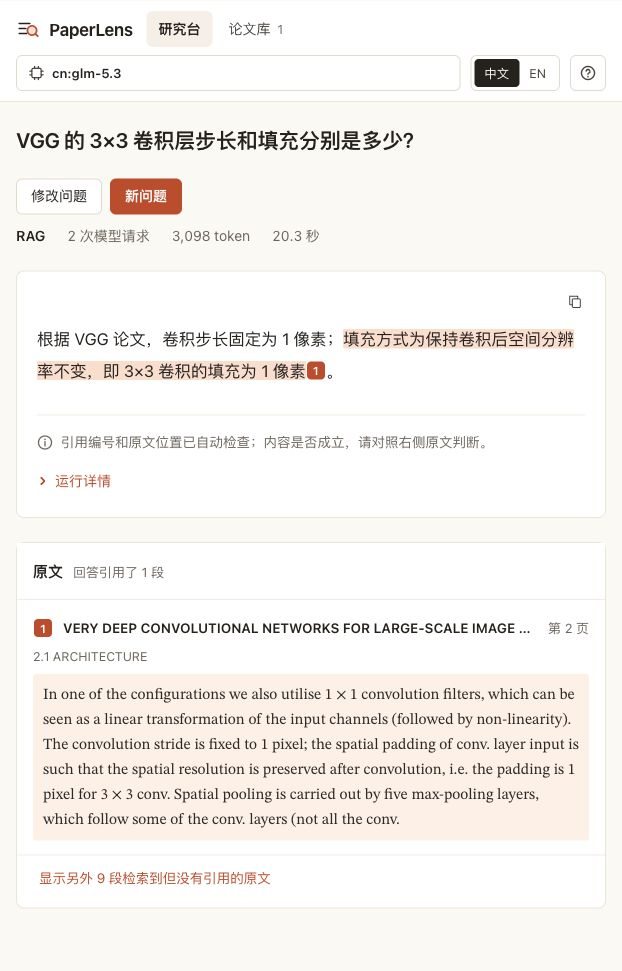

# Mac 安装、启动与前端实际操作验收

日期：2026-10-24（Asia/Shanghai）。本轮完成用户授权的安装启动闭环及前端使用验收，并记录 GitHub 本机下载分发方案；没有制作安装包、发布 GitHub Release 或推送仓库。

## 结论与范围

在 macOS 26.6.2 / Apple Silicon / Python 3.11.9 下，从本地提交 `5a4cd858ecbf288656f3523108f4560a6151607b` 导出源码，叠加本轮必要修复和依赖快照后，使用全新 `.venv` 在线安装并完成“启动 → 空库上传 → 建库 → 配置 → 问答 → 引用 → 刷新 → 重启”。没有复制原虚拟环境、八/九篇版本、网页指针或原上传任务。

本地 MiniLM/BGE 权重复用 `/Users/j/.cache/huggingface` 缓存；问答阶段单独复用已有本机网关和私有模型配置。它验证独立环境和空知识库的闭环，不等于另一台机器、全部权重冷下载、Windows 或可执行安装包已经通过。

新环境检查：49 个固定版本包与实际安装一致，`include-system-site-packages=false`，`pip check` 通过；本地 Embedding 为 384 维，BGE 正常加载。31 项网页检查通过，向量模型使用替身；后端 345 项属于此前结果，本轮未重跑。

- [环境与导出方法](environment.json)、[依赖一致性](dependency_check.json)、[安装后包清单](installed_environment_after.json)
- [在线安装输出](pip_install.txt)、[安装报告](pip_install_report.json)、[首次沙箱网络失败](pip_install_sandbox_failure.txt)
- [缓存模型加载](model_prepare.json)、[加载输出](model_prepare.txt)、[独立环境31项检查](isolated_webui_tests.txt)
- [用户安装说明](../../INSTALL_AND_START.md)、[本机分发方案](../../LOCAL_DISTRIBUTION.md)

## 发现并修复的问题

| 问题 | 原始信号 | 最小修复与回归 |
| --- | --- | --- |
| 新下载副本首页500 | 元数据先后两次读取未随Git迁移的八篇版本；与模型/API无关 | 元数据使用网页库和公开模型配置；无旧基线时显示空库。[原始失败](fresh_clone_before_fix.json)、[红](fresh_meta_red.txt)、[绿](fresh_meta_green.txt)、[定位](diagnosis.json) |
| 首篇上传不能建库 | 入库函数要求已有索引，空库会去读取不存在的legacy资产 | 首篇以新向量维度创建空索引，再按原有配对校验和原子发布流程提交。[红](first_import_red.txt)、[绿](first_import_green.txt) |
| 空库仍能创建问答worker | 合法提问返回202并创建无效任务 | 网页禁用发送；后端在创建目录/worker前拒绝并提示先上传PDF。[红](empty_question_red.txt)、[绿](empty_question_green.txt) |
| VGG标题变成首字母 | 最大字号过滤丢掉了同一标题行的小型大写字母 | 选中标题行后保留全行，继续排除竖排水印。[红](title_red.txt)、[绿](title_green.txt)、[真实PDF核对](title_validation.json) |
| 旧测试绑定作者数据 | 元数据隐私检查要求至少8篇，在新用户的一篇库中失败 | 用独立配置夹具验证公开模型字段与密钥不泄露。[失败](portable_meta_test_red.txt)、[最终31项](isolated_webui_tests.txt) |
| 空问题提示残留在回放页 | 提交空问题后打开案例，原“先写下问题”提示仍可见 | 成功提交或加载案例后清除旧提示；浏览器重现与复验，未新增模型请求。[修复前](screenshots/11_stale_notice_before.png)、[修复后](screenshots/12_source_unavailable.png) |

没有改动检索、Agent/Auto预算、回答提示、原实验结果或原知识库。首次八篇基线存在的旧工作区继续沿用原行为；显式网页指针异常仍会显示失败，不静默换库。

## 实际网页操作

网页主要由Codex内置浏览器操作；启动脚本打开Safari，也检查了其首页、模型预填、RAG选择和键盘操作。中文选词验证由用户用真实键盘完成并回复“选词后没有发送”，没有把自动化插入文字冒充真实输入法事件。用户选词时的具体浏览器未独立记录。[人工确认](manual_ime.json)

| 操作 | 实际结果 |
| --- | --- |
| 无配置、无八篇库首次启动 | 首页200、0篇/0段、可添加PDF、禁止提问；已保存案例仍可打开 |
| 第一篇VGG上传 | 后台提取正文、基础清理、语义分块与编码，发布1篇/160段/384维配对库；完整标题保留 |
| 入库中刷新 | 接续已有导入，完成后自动更新论文数；该次仅一个导入任务，未重发上传 |
| 同内容VGG再次上传 | 提示重复跳过，仍1篇/160段，指针未切换 |
| 无正文PDF | 显示不支持OCR/无足够正文；失败后当前指针及原库保持 |
| 模型设置 | 地址、模型预填，密钥栏空；获取21个模型后选择同一模型并保存；额外选项保留 |
| Shift+Enter / Enter | 前者仅换行，后者创建一个问答任务；RAG模式禁用联网开关 |
| 问答中刷新 | 接续同一任务；服务HTTP记录只有一个`POST /api/run` |
| 引用联动 | 界面编号1对应原引用7，打开VGG第2页原文并高亮对应句子 |
| 中英界面切换 | 标签切换，原中文答案和引用保留，无重新生成 |
| 当前622px窄视口 | 内容宽度622px，无横向溢出；未覆盖所有屏幕尺寸 |
| 已保存成功/来源不可用案例 | 标明回放未调用模型；失败案例保留暂时无法核实和缺口说明 |
| 重复启动 | 启动器返回已有服务提示，8849只有一个监听进程 |
| Ctrl+C退出 | 启动器退出码0，8849连接被拒绝，没有遗留服务 |
| 再次启动并刷新旧问答 | 论文库仍1篇/160段；旧任务404，页面说明没有重发，运行文件仍在 |

原始导入记录包括修复标题前后两次首篇建库、一次重复跳过、一次无正文失败，共四次上传；未隐藏第一轮标题截断结果。[导入记录](import_results.json)、[HTTP计数](http_counts.json)、[启动输出](launcher_console.txt)、[启动/退出检查](launcher_check.json)、[重启记录](restart_check.json)、[重启输出](restart_console.txt)

## 一次真实问答及成本

问题：“VGG 的 3×3 卷积层步长和填充分别是多少？”固定RAG、联网关闭、请求模型 `cn:glm-5.3`，使用本轮新建的单篇库 `webui-ffce83facaf74bdcbe9690340b1811fe`。

- `completed`，`stop_reason=rag_answer`；RAG的`answer_status=not_reviewed`，不冒充Agent复核通过。
- 20.32秒，2次生成服务请求，0失败、0自动重试。
- 输入3030、输出68、总计3098 token；未估算货币费用。
- 回答步长1像素、3×3卷积填充1像素；原引用7为VGG第2页，已对照PDF页文确认。
- 10条运行引用注册原文均与当前版本保存的片段逐字段一致。
- 模型列表另有1次网关`/models`请求；入库、回放不生成回答，没有新arXiv请求。

这是安装闭环和已知题检查，不是独立新题质量评测，也没有与不同模型/不同库的旧耗时比较。

[实际结果](live/result.json)、[运行输出](live/console.txt)、[成本汇总](live_summary.json)、[人工原文核对](manual_review.json)、[本次配对库](fixture_kb/versions/webui-ffce83facaf74bdcbe9690340b1811fe/manifest.json)

## 数据保留与收尾

开始前对5115份既有文件留哈希，排除`.git`、原`.venv`、缓存和本报告目录。最终核对只修改本轮对应代码、测试和说明文件；既有知识库、上传、日志、实验原始文件及私有配置保持原字节。具体变更及核验见[文件核对](verification.json)和[最终补丁](task_changes.patch)。本轮新增文档另列，不混入原文件数。

临时服务和测试标签页均关闭，Safari恢复原起始页；隔离副本的私有配置已删除。隔离环境、测试输入、各版本与运行记录保留；最终配对库另存本报告，避免仅依赖临时目录。[清理核对](cleanup.json)

新下载包下一阶段需包含运行时、启动入口、首次模型准备与可写用户数据目录，再以最终包重复完整流程；Windows还需替换/验证导入锁与启动方式。本轮没有新增打包依赖，没有制作安装包或执行GitHub发布。
