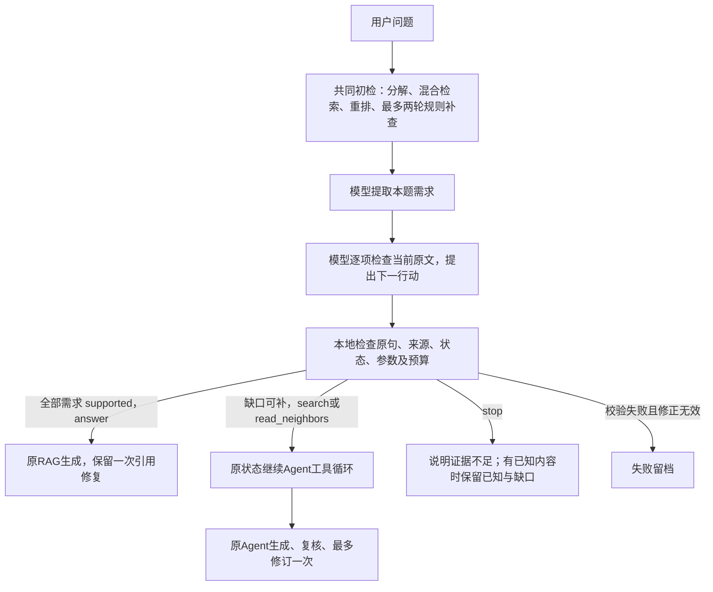

# Auto 的设计、接入作用与使用

本轮目标是让日常入口根据当前证据选择处理深度，保留显式RAG和Agent用于比较。没有增加框架、外网搜索或新工具；代码继续使用普通函数、字典和列表。

## 一次请求如何流动



这里的direct是“当前检索证据已经足够，直接进入生成”，仍然有模型规划和证据判断成本。Auto没有额外调用一个只看问题复杂度的分类模型；规划与判断直接复用已有Agent能力。

## 每项接入解决什么问题

| 接入 | 作用 | 为什么需要 | 代价或边界 |
| --- | --- | --- | --- |
| 共同初检后判断 | 路由依据包含实际原文，而非只看问题长短 | 短问题也可能缺原文，跨篇问题也可能一次检索齐全 | 所有Auto请求都要先检索，不能省掉初检 |
| 原需求规划与证据检查 | 根据用户明确所问逐项判断supported/partial/missing/conflicting | “检索到论文”不等于“找到该事实”；避免只看来源数量就直答 | 通常额外2次模型请求，允许共享预算内一次格式修正 |
| direct分支 | 复用原RAG提示生成，并保留引用编号检查和最多一次修复 | 初检足够时，可省去Agent的逐项答案复核 | 门控不是答案语义复核；生成仍可能遗漏、误引或失败 |
| 首次工具行动前暂停 | 先落盘路由，再决定是否继续工具循环 | 需要让路由可见，同时复用已有循环，不复制第二套Agent | 暂停状态不能当完成状态读入回答 |
| 同目录、同协议继续 | 复用原计划、判断响应、证据和已用修正额度 | 防止重新规划导致额外费用、范围变化、预算重置 | 只复用精确成功记录；源码/输入/设置变化拒绝续接 |
| stop分支 | 无法从当前库建立必要事实时说明缺口 | 额外搜索不能创造库内不存在的原论文或测量值 | 全missing本地返回、回答阶段0请求；partial/conflicting仍用原回答流程保留已知/争议 |
| routing.json及既有账本 | 保存初始行动、理由、需求状态和实际调用 | 可以追查错路由、重复规划和成本，支持后续量化 | 日志不是模型判断正确的证明，仍需语义审阅 |
| 显式rag/agent/auto | 正常使用无需手选，实验仍可固定路径 | 兼顾日常体验与可复核对照 | CLI默认auto；Python函数默认rag以保持旧评估接口兼容 |

## 最小实现位置

- `main.py::_answer_with_agent()`：Auto先调用`run_diagnostics(..., route_only=True)`，根据已校验行动映射direct/agent/stop/failed，先写routing.json；工具分支同目录继续；direct使用原build_prompt和repair_citations_once。
- `agent.py::run_diagnostics()`：只增加有预算循环的“首次工具执行之前暂停”能力；route_only是执行游标，不改变输入、模型或预算。恢复时依赖现有精确响应审计器，不新增网络请求去重复规划/判断。
- `tests/test_main_auto.py`：9项行为回归覆盖直答、补查、停止、引用修复/失败、暂停再续接、共享修正额度和CLI默认值。此前230项也保留。

预算保持每题最多1次分解、6次决策、4次回答，共11次模型请求；最多3次本地工具行动，最多32段/24000字符证据；网络和截断不自动重试。direct最多1次生成+1次引用修复，不额外扩张总上限。失败不自动换到其他路径掩盖结果。

## 使用和产物

```bash
# 日常默认Auto，使用八篇库
.venv/bin/python main.py "What batch size does DPR use?"

# 显式选择，便于演示或对照
.venv/bin/python main.py --mode auto "..."
.venv/bin/python main.py --mode agent "..."
.venv/bin/python main.py --mode rag --kb-version all-papers-8-20261020 "..."
```

Python调用为`main(query, mode='auto')`；省略mode仍是原rag。Auto/Agent默认日志分别在`logs/auto_runs/`和`logs/agent_runs/`；也可用`--output-dir`指定新的空目录。根目录有protocol、retrieval、actual_chat_calls、routing（仅Auto）和result；loop保存需求、判断、工具及停止；answer保存直答或原Agent的草稿/复核记录。

Auto/Agent目前只支持`all-papers-8-20261020`。原激活指针仍是`semantic-mac-20261019`，未切换；固定RAG省略版本时继续读取该指针。比较时必须明确使用相同八篇库。

## 验收与解释范围

239项离线回归已通过；新增9项先运行失败、实现后通过，日志保留。本轮另冻结8道新题，对RAG、固定Agent、Auto各跑一次并审阅，详见同目录report、summary和manual_review。新的评分点区分必答和补充，历史12题分数和3题开发回归仍独立保留。

Auto省掉的是适当路径上的额外处理，不能预先保证比固定RAG更便宜、更快或更准；如果大部分初检已足够，固定RAG本就有成本优势。最终解释以这次实际质量、路由与请求账本为准。
